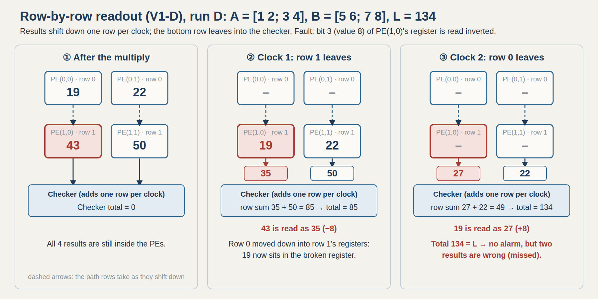
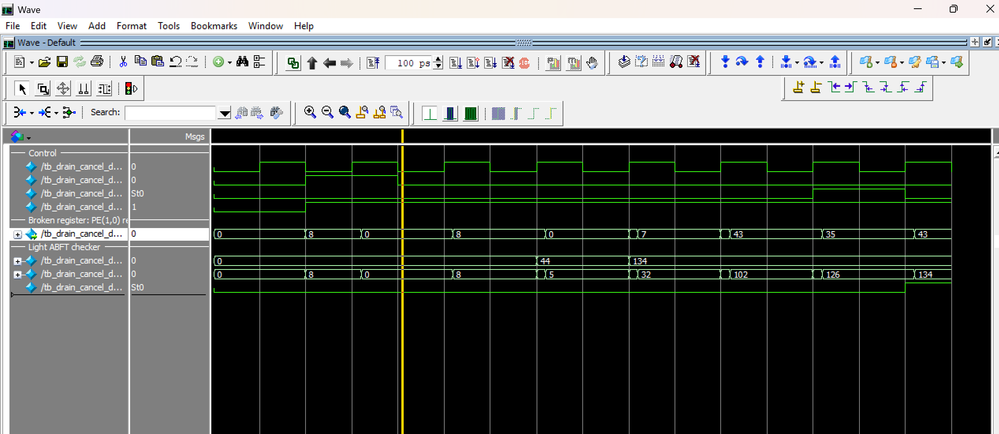
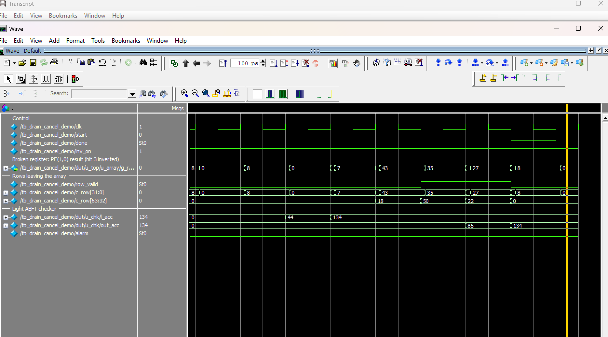
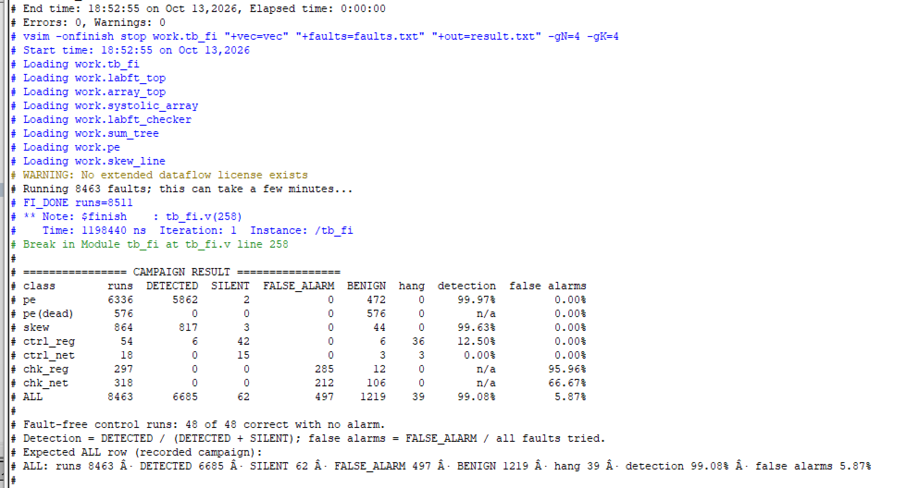
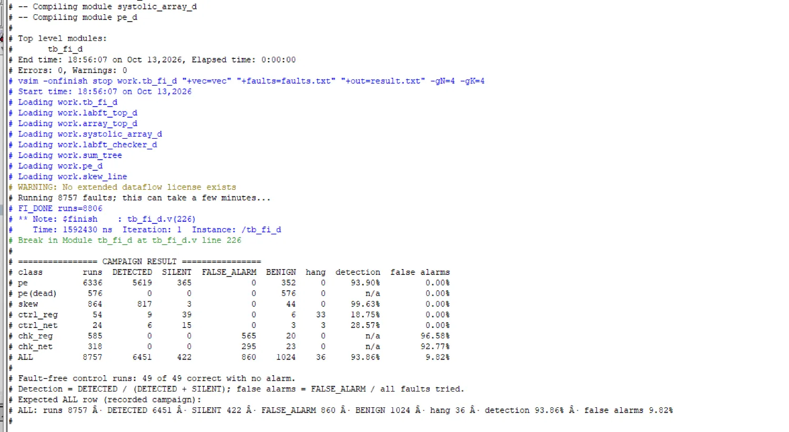

# Light ABFT on Systolic Arrays: blind spots and low-cost fixes

[](https://github.com/vtejareddy14-crypto/light-abft-systolic-array/actions/workflows/simulate.yml)


Run-time error detection for matrix-multiplication hardware (the core of AI
accelerators), implemented in Verilog, tested with exhaustive fault-injection
campaigns, and synthesized for the Xilinx Zynq XC7Z020 FPGA.

**Highlights**
- Built **Light ABFT** (Libano et al., *IEEE Trans. Computers*, 2023), a
  single-checksum error check, on **output-stationary** and
  **weight-stationary** systolic arrays.
- Found a **blind spot**: one fault in a register that several results pass
  through can push one result up and another down by the same amount, so the
  checksum does not change and the error is missed. It also affects the base
  paper's own weight-stationary dataflow.
- Closed it with a **doubling (time-weighted) checksum**:
  `S ← 2·S + new` on both sides of the check. Missed errors in the array's
  registers: **968 → 0** (weight-stationary) and **365 → 0** (output-stationary,
  row-by-row readout).
- Measured the base paper's suggested **duplicated checker**: false alarms
  **1,275 → 9**. With both fixes: **98.83 % detection, 0.08 % false alarms**.
- Measured the checker's FPGA cost for two readout styles on the base paper's
  chip: **2,156 LUTs at 98.7 MHz** (parallel) vs **365 LUTs at 121.3 MHz**
  (row by row), 8 × 8 array.

## Quick start

```
make test       # self-checking tests: output-stationary and weight-stationary designs
make demo       # the blind spot: plain checker misses the fault, doubling checker detects it
make campaign   # a full fault campaign (default W3; e.g. make campaign V=v1d)
```
Requires Icarus Verilog 12 (tested) and, for campaigns, Python 3 with NumPy.
ModelSim and Vivado commands are given below.

## How Light ABFT works

The sum of all outputs of `C = A × B` can be computed from the inputs alone:

```
L = Σt (sum of column t of A) × (sum of row t of B)        S = Σi,j C[i][j]
```

If the hardware is correct, `L = S`. One comparison per multiplication raises
an alarm when they differ.

```
A = [1 2; 3 4], B = [5 6; 7 8]  ->  C = [19 22; 43 50]
L = (1+3)(5+6) + (2+4)(7+8) = 44 + 90 = 134      S = 19+22+43+50 = 134   OK
if 43 becomes 35:  S = 126 != 134  ->  alarm
```

## The blind spot

In an output-stationary array the results stay inside the processing
elements and must be read out. With **row-by-row readout**, results pass
through the registers of the rows below them. One inverted bit (bit 3, value 8)
in such a register changes **43 → 35 (−8)** and then **19 → 27 (+8)**: the total
stays 134 and the error is missed. The same fault with **parallel readout**
changes only 43 and is detected (126 ≠ 134).



| Parallel readout: detected | Row-by-row readout: missed |
|---|---|
|  |  |

In the **weight-stationary** dataflow (the base paper's), partial sums flow
down each column, so every register of a column is shared by **all** results
of that column, and the effect is stronger.

## The fixes

| Problem | Fix | Cost |
|---|---|---|
| Errors cancel in the total | **Doubling checksum**: double the running total before each add, on both sides (`S ← 2·S + new`). Results passing a register at different clocks get weights 1, 2, 4, …, so equal-size errors cannot cancel. | shifts + wider totals |
| False alarms from faults inside the checker | **Duplicated checker** (the base paper's suggestion): alarm only if both checkers agree; one alone reports a checker fault | a second checker |

## Design decisions

| Decision | Alternatives considered | Why |
|---|---|---|
| Light ABFT: one checksum per multiplication | Duplicate or triplicate the array; full row/column ABFT | One extra multiplier and a few adders; on an alarm, recompute |
| Checker reads the raw, unskewed inputs | Tap the skewed array edge | All numbers of one step arrive in the same clock, so one adder tree per side |
| Two OS readouts: parallel and row by row | Column by column (symmetric), serial multiplexer (as costly as the tree) | The direct option vs the cheap streaming option |
| Both checksum sides wrap modulo 2^32 (2^(32+2N) with doubling) | Saturating arithmetic | Saturation breaks L = S; equal wrapping never causes a false alarm |
| Fault injection from the testbench | Hooks in the RTL; FPGA configuration-bit flips | Hardware files stay unchanged; every register bit reachable; exhaustive and repeatable |
| One file per design version | Editing a single design | V1 − V0 is exactly the checker's cost |
| Duplicated checker: alarm only when both agree | Alarm when either alarms | A fault inside one checker is reported as a checker fault, not an error |
| Doubling checksum (`S ← 2·S + new`) | Wider total only; modular residue codes; full ABFT | Removes equal-and-opposite cancellation with shifts and wider totals |

## Results

**Fault campaigns** (simulation, 4 × 4 array, every register bit and control
wire, stuck-at-0 / stuck-at-1 / inverted, 3 random int8 matrix pairs):

| Design | Missed errors in PE registers | Detection | False alarms |
|---|---|---|---|
| V1: output-stationary, parallel readout | 2 | 99.08 % | 5.87 % |
| V1-D: output-stationary, row-by-row readout | 365 | 93.86 % | 9.82 % |
| **V1-DW: row by row + doubling checksum** | **0** | **99.17 %** | 10.82 % |
| W1: weight-stationary, Light ABFT | 968 | 83.50 % | 13.90 % |
| W2: weight-stationary, duplicated checker | 968 | 83.50 % | 0.08 % |
| **W3: weight-stationary, doubling checksum** | **0** | **98.83 %** | 16.07 % |
| **W4: weight-stationary, both fixes** | **0** | **98.83 %** | **0.08 %** |

The remaining misses are controller faults, which affect the array and the
checker in the same way.

**FPGA cost** (Vivado, XC7Z020-3, 8 × 8, out of context, 10 ns target):

| Design | Total LUT | Checker LUT / FF | WNS | Fmax |
|---|---|---|---|---|
| V0: array, no checker | 6,664 | – | +2.354 ns | 130.8 MHz |
| V1: parallel readout + checker | 8,829 | 2,156 / 33 | −0.136 ns | 98.7 MHz |
| V0-D: row-by-row readout, no checker | 8,636 | – | +1.402 ns | 116.3 MHz |
| V1-D: row-by-row readout + checker | 9,040 | 365 / 65 | +1.753 ns | 121.3 MHz |

The parallel checker adds 64 results in one clock (63 adders, 6 levels) and
misses the 10 ns target; the row-by-row checker adds 8 results per clock.
FPGA cost of the weight-stationary designs and of the two fixes: in progress
(`synth/vivado/synth.tcl`).

| Fault campaign, parallel (V1) | Fault campaign, row by row (V1-D) |
|---|---|
|  |  |

## Repository layout

```
rtl/              Verilog designs
  pe.v, systolic_array.v, skew_line.v, array_top.v      output-stationary array (V0)
  labft_checker.v, labft_top.v, labft_top_2.v            Light ABFT, parallel readout (V1, V2)
  *_d.v, labft_top_d2.v, labft_checker_dw.v, labft_top_dw.v
                                                         row-by-row readout (V0-D, V1-D, V2-D, V1-DW)
  pe_ws.v, systolic_array_ws.v, ws_top.v, labft_*_ws*.v  weight-stationary (W0 - W4)
  sum_tree.v                                             adder tree
tb/               testbenches: self-checking, demos, fault-injection campaigns
fi/               fault-site list generator and campaign runner (Python)
scripts/golden.py random test matrices and golden results
synth/vivado/     Vivado script, clock constraint, 8 x 8 top files
docs/images/      ModelSim and Vivado screenshots
Makefile          make test | demo | campaign
.github/workflows CI: runs the tests and demos on every push
```

## How to run

**Self-checking test** (ModelSim or Icarus Verilog):
```
vlog tb/tb_standalone.v rtl/labft_top.v rtl/labft_checker.v rtl/sum_tree.v rtl/array_top.v rtl/systolic_array.v rtl/pe.v rtl/skew_line.v
vsim -c tb_standalone -do "run -all"
```

**The blind-spot demo** (row-by-row readout; add `+define+DW` and the
`labft_*_dw.v` files for the doubling checker):
```
vlog +define+DRAIN tb/tb_drain_cancel_demo.v rtl/labft_top_d.v rtl/labft_checker_d.v rtl/sum_tree.v rtl/array_top_d.v rtl/systolic_array_d.v rtl/pe_d.v rtl/skew_line.v
vsim -c tb_drain_cancel_demo -do "run -all"
```

**A fault campaign** (Python 3 + NumPy + Icarus Verilog; also `make campaign`):
```
python3 fi/campaign.py --variant w3 --n 4 --k 4 --kind persistent
```
Variants: `v1 v1d v1dw v2 v2d w1 w2 w3 w4`. The summary is written to
`results/fi/<tag>/summary.md`.

**FPGA cost** (Vivado Tcl console, repository root):
```
set design w3; source synth/vivado/synth.tcl
```

## Limitations

Fault injection is done in RTL simulation (register and wire faults), not by
radiation or FPGA configuration-bit flips as in the base paper, so the
absolute numbers are not directly comparable with the paper's. Campaigns use
4 × 4 arrays and random int8 inputs. The doubling checksum guarantees that
equal-size errors cannot cancel; errors of different sizes and controller
faults are not covered.

## Reference

F. Libano, P. Rech, J. Brunhaver, "Efficient Error Detection for Matrix
Multiplication With Systolic Arrays on FPGAs," *IEEE Transactions on
Computers*, vol. 72, no. 8, pp. 2390–2403, 2023.

## Authors

V Sai Teja Reddy, VIT University, School of Electronics Engineering (SENSE).
